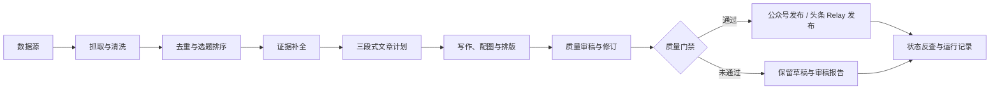

# 内容自动发布系统

这是一个面向公众号与今日头条的内容生产和定时发布系统。系统从已配置的数据源抓取
时效内容，完成选题、证据核验、写作、审稿、排版和配图，再按各平台的发布规则执行
草稿或正式发布。

项目将“内容生成”和“平台发布”分离：公众号使用官方发布能力；今日头条使用独立的
浏览器 Relay 保存单账号登录态并执行发布。两端共用同一套选题、正文和图片策略，但
分别保存任务状态、发布记录和失败截图。

## 系统能力

- **多源选题**：支持网页、RSS、搜索和社区数据源，按时效、去重、热度、可信度和
  账号定位筛选内容。
- **三段式文章**：一篇文章由三个独立内容块组成，每个内容块安排一张相关插图；有
  可用原文图时优先使用，缺图时由图片能力补齐。
- **质量门禁**：保留来源、证据、风险项、质量报告和修订记录；高风险事实或质量不达标
  的内容不会自动公开发布。
- **公众号发布**：支持封面、正文图片、草稿创建、定时群发和发布状态查询。
- **今日头条发布**：支持浏览器登录态持久化、草稿、系统定时直接发布、文章状态反查、
  幂等控制和失败截图。
- **运行管理**：Dashboard 可查看任务、产物、质量报告、失败原因和调度状态，并调整
  数据源、文章方案和定时规则。
- **部署守护**：主服务与头条 Relay 可以作为独立 systemd 服务运行；服务器重启后会
  恢复调度检查。

## 工作流



## 运行环境

- Deno 2 或更高版本。
- 用于正文生成的兼容 OpenAI 接口的大模型。
- 需要正式发布公众号时：已开通的公众号凭证和固定出口 IP，或微信公众号 Relay。
- 需要正式发布今日头条时：服务器 Chrome、独立浏览器资料目录，以及首次扫码登录。

## 快速开始

### 1. 创建配置

```bash
cp trendpublish.config.example.ts trendpublish.config.ts
```

在 `trendpublish.config.ts` 中至少配置服务鉴权和大模型能力。建议先保持
`features.article.dryRun: true`，只生成本地预览，不上传或发布。

### 2. 检查环境并生成预览

```bash
# 检查配置、依赖和发布前置条件
deno task doctor

# 运行一篇本地预览：不上传图片、不创建草稿、不发布
deno task article --dry-run

# 启动 API 服务与 Dashboard
deno task dev
```

启动后可访问：

```text
Dashboard：http://localhost:8000/dashboard
API：http://localhost:8000
```

运行产物默认写入 `src/temp/`，包括来源快照、文章计划、HTML、图片、审稿结果和错误
信息。该目录包含运行数据，不应提交到版本库。

## 发布配置

### 公众号

公众号发布配置位于 `providers.publish.weixin` 与
`features.article.publisher`。建议先使用草稿模式验证排版，再启用自动公开发布。

```ts
features: {
  article: {
    dryRun: false,
    publisher: {
      provider: "weixin",
      publishMode: "mass",
    },
  },
},
```

公众号真实发布前，必须在公众号后台配置发布服务器的出口 IP 白名单。

### 今日头条

今日头条采用“主服务调度 + 头条 Relay 执行”的方式。主服务在目标时间前生成文章，
到达目标时间后由 Relay 打开头条创作中心并直接发布，不使用头条页面原生定时发布。

首次部署需要在 Relay
所在服务器扫码登录一次。登录态会保存在独立浏览器资料目录中，
后续服务重启会继续复用。不要复制、公开或提交该目录。

启动 Relay：

```bash
TOUTIAO_RELAY_TOKEN=请设置高强度随机令牌 deno task toutiao:relay
```

服务器部署、扫码登录、环境变量和 systemd 守护说明见
[今日头条 Relay 文档](docs/toutiao-relay.md)。

## 定时任务与安全策略

- 公众号定时任务由 Dashboard 的运行时配置管理，建议每个账号只保留一个启用计划。
- 今日头条默认每日 11:00 执行，生成窗口默认提前 150 分钟；可以通过服务器环境变量
  调整。
- 质量门禁默认开启。存在高风险事实、正文过短、封面缺失或平台前置条件不满足时，任务
  会被阻止或保留为草稿，而不是强行发布。
- 发布与反查均使用幂等键，避免服务重启或重试导致重复创建文章。
- 头条 Relay
  仅应监听本机回环地址；浏览器资料、截图和状态文件均属于敏感运行数据。

## 常用命令

```bash
# 配置与质量检查
deno task doctor
deno task test
deno task verify

# 内容生成与预览
deno task article --dry-run
deno task preview

# 本地服务
deno task dev
deno task dashboard

# 发布 Relay
deno task relay
deno task toutiao:relay

# Docker 与 Cloudflare 工具
deno task docker
deno task cf dry-run
```

## 项目结构

```text
src/
  app/weixin-article/       应用组装、运行时配置和抓取规划
  features/weixin-article/ 内容选题、写作、审稿、排版和工作流
  apps/toutiao-relay/       今日头条浏览器 Relay
  controllers/              定时调度、任务状态与 API 控制器
  integrations/             大模型、抓取、图片、发布与通知适配器
  platform/                 本地与 Cloudflare 存储实现
  utils/config/             配置解析与校验
deploy/systemd/             主服务与头条 Relay 守护模板
docs/                       部署、配置、模板和接口说明
```

## 文档

- [配置说明](docs/configuration.md)
- [部署说明](docs/deployment.md)
- [今日头条 Relay](docs/toutiao-relay.md)
- [架构说明](docs/architecture.md)
- [模板说明](docs/templates.md)
- [接口说明](docs/api/json-rpc-api.md)

## 许可

本项目采用 [MIT License](LICENSE)。
